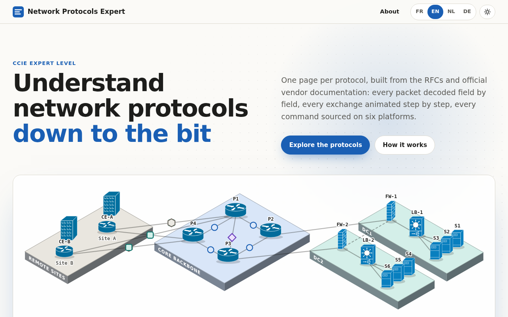

# Network Protocols Expert

[](https://learning.cuvelier.tech)
[](https://www.w3.org/TR/WCAG22/)
[](#languages)
[](LICENSE)
[](https://creativecommons.org/licenses/by-sa/4.0/)
[](https://reuse.software/)

An expert-level learning library for network protocols, written to master each protocol
in depth and to prepare the expert certifications of the major network and security vendors.
One self-contained HTML page per protocol, in French, English, Dutch and German.

**Read it at <https://learning.cuvelier.tech>.**

[](https://learning.cuvelier.tech)

> **Source of truth: GitLab.com** (private). This GitHub repository is a read-only push
> mirror: pull requests are disabled and any change pushed here would be overwritten.
> Corrections and suggestions are welcome as [issues](https://github.com/jeanmichel4121/network-protocols-expert/issues/new/choose).

## Contents

- [Target level](#target-level)
- [What every page contains](#what-every-page-contains)
- [Languages](#languages)
- [Protocols](#protocols)
- [Quality gates](#quality-gates)
- [Repository layout](#repository-layout)
- [Local preview](#local-preview)
- [Contributing and feedback](#contributing-and-feedback)
- [Security](#security)
- [License](#license)
- [Acknowledgements](#acknowledgements)

## Target level

Each page aims at the knowledge expected at the highest certification level of each vendor
covered (names as published by the vendors, checked October 2026):

| Vendor | Expert-level certification | Reference |
|---|---|---|
| Cisco | CCIE (Enterprise Infrastructure, Security, Data Center, Service Provider) | [Cisco CCIE](https://www.cisco.com/site/us/en/learn/training-certifications/certifications/index.html) |
| Check Point | Check Point Certified Security Master (CCSM) and Security Master Elite (CCSM-E) | [Check Point certification](https://www.checkpoint.com/support-services/certification/) |
| Palo Alto Networks | Network Security Architect (Architect level; Next-Generation Firewall Engineer at Specialist level) | [Palo Alto Networks certification](https://www.paloaltonetworks.com/services/education/certification) |
| Fortinet | Fortinet NSE 8 (expert level of the NSE program, previously Fortinet Certified Expert, FCX) | [Fortinet NSE program 2026](https://helpdesk.training.fortinet.com/support/solutions/articles/73000665747-what-is-changing-in-the-nse-certification-program-in-2026-) |
| F5 | F5 Certified Solution Expert (F5-CSE Security, F5-CSE Cloud) | [F5 certifications](https://education.f5.com/certifications) |
| NetScaler | NetScaler certification, Expert level | [Citrix training and certifications](https://www.citrix.com/training-and-certifications/) |

The pages are an independent study resource. They are not affiliated with, endorsed by or
sponsored by any of these vendors.

## What every page contains

The same nine sections, in the same order:

1. **Header**: definition, OSI layer, encapsulation (EtherType, IP protocol, port), standards.
2. **Concepts**: purpose, terminology, design trade-offs, versions and variants.
3. **Packet formats**: every message type shown twice and kept in sync, as an RFC-style
   bit diagram (32-bit rows, true field widths) and as a Wireshark-style tree with the
   display-filter name of each field. Sample packets are generated by
   [`tools/packet-builder.py`](tools/packet-builder.py), never hand-written.
4. **Operation**: state machines and message exchanges, animated step by step, with timers.
5. **Advanced behaviour**: edge cases, interoperability, scaling, security, convergence.
6. **Multi-vendor configuration and verification**: Cisco, Check Point, F5 BIG-IP,
   Palo Alto Networks, NetScaler and Fortinet FortiGate, each command block citing the
   vendor document and software version it was checked against.
7. **Troubleshooting**: a yes/no decision tree and a table of common faults.
8. **Quiz**: at least 15 scenario-based questions, each with its explanation and reference.
9. **Sources**: RFCs with section numbers, IEEE and IANA registries, vendor documentation.

Every page opens offline (no CDN, font or network call), works in light and dark mode,
down to 360 px wide, with the keyboard, and prints the current language only.

## Languages

French, English, Dutch and German, with identical content. Field names, states, message
names, CLI commands and Wireshark filters stay in English in every language, as on the
devices. Each language has its own URL (`/fr/`, `/en/`, `/nl/`, `/de/`) with `hreflang`
links; the switch in the header changes language without reloading the page.

## Protocols

| Protocol | Scope | Status |
|---|---|---|
| Ethernet | Ethernet II, IEEE 802.3 LLC/SNAP, IEEE 802.1Q | In progress |

The list on the [home page](https://learning.cuvelier.tech) is always current.

## Quality gates

Nothing reaches the site without a green pipeline. All jobs run on self-hosted ARM64
runners, with images pinned by digest and Python tools pinned by hash.

| Stage | Checks |
|---|---|
| lint | YAML, Python (ruff), Conventional Commits, branch name and merge request title, licensing (REUSE) |
| test | packet-builder self-test, static page checks (self-contained, 4 languages complete, packets equal to the builder output, shared template blocks unchanged) |
| security | secret scanning (gitleaks); weekly report of outdated pins (Python tools, image digests, hooks, axe-core) |
| build | one URL per language, `hreflang`, canonical, Open Graph, JSON-LD, sitemap, `security.txt`; CycloneDX SBOM of the build tooling |
| verify | HTML validation, links between pages, every protocol listed; headless browser: axe WCAG 2.2 AA in light, dark and mobile, layout shift, reduced motion, no external request |
| deploy | atomic release to <https://learning.cuvelier.tech>, smoke-tested, from `main` only |
| release | release notes from [`CHANGELOG.md`](CHANGELOG.md) on `vX.Y.Z` tags, with website, SBOM and source links |

Every repository setting of both forges (branch protection, merge rules, runners, mirror,
security features) is documented with its reason in
[`docs/repository-settings.md`](docs/repository-settings.md) and checked by
`scripts/audit_repos.py`. Design decisions are recorded in [`docs/adr/`](docs/adr/README.md).

## Repository layout

```
.
├── index.html                    home page (protocol list, 4 languages)
├── templates/protocol-template.html   reference page copied by every protocol page
├── protocols/<slug>/             one folder per protocol: index.html + sources.md
├── tools/                        packet builder, shared-block sync, home-page topology, icons
├── scripts/                      site build, page checks, browser tests, labels, releases
├── docs/                         standards, repository settings, decision records (adr/), screenshots
├── requirements/                 pinned CI tooling (with hashes)
├── .gitlab/  .github/            merge request and issue templates, label taxonomy
├── LICENSES/  REUSE.toml         licence texts and per-file licensing
└── CLAUDE.md                     authoring rules for every page
```

## Local preview

Requirements: Python 3.12 or later.

```sh
python3 scripts/build_site.py public      # build the site with one URL per language
python3 -m http.server -d public 8000      # then open http://127.0.0.1:8000/
```

The pages also open directly from the file system (`index.html`, `protocols/<slug>/index.html`).
Checks run locally with [pre-commit](https://pre-commit.com/), as in CI:

```sh
pip install pre-commit
pre-commit install --install-hooks -t pre-commit -t commit-msg
pre-commit run --all-files
```

## Contributing and feedback

- **Found an error?** Open an issue with the *Correction* form and give the authoritative
  source (RFC section, vendor document and version). Issues in French, English, Dutch or
  German are welcome.
- **Want a protocol covered?** Use the *New protocol* form.
- Work happens on GitLab with trunk-based development: short-lived branches, merge requests,
  squash merges on a green pipeline. See [`CONTRIBUTING.md`](CONTRIBUTING.md) and the
  authoring rules in [`CLAUDE.md`](CLAUDE.md).
- Everyone taking part follows the [Code of Conduct](CODE_OF_CONDUCT.md).

## Security

Please report vulnerabilities privately, not in a public issue: see [`SECURITY.md`](SECURITY.md).
The site also publishes [`/.well-known/security.txt`](https://learning.cuvelier.tech/.well-known/security.txt) (RFC 9116).

## License

- **Code** (scripts, tools, template, configuration): [MIT](LICENSE).
- **Content** (protocol pages, home page, documentation): [CC BY-SA 4.0](LICENSES/CC-BY-SA-4.0.txt).
  You may reuse and adapt it, with attribution, under the same licence.
- **Cisco network topology icons** (`tools/icons/cisco/`, embedded in the home page): property of
  Cisco Systems, Inc., used unaltered under [Cisco's terms](LICENSES/LicenseRef-Cisco-Network-Topology-Icons.txt).

Per-file licensing is declared in [`REUSE.toml`](REUSE.toml) and checked in CI. To cite the
library, use [`CITATION.cff`](CITATION.cff) (GitHub: *Cite this repository*).

## Acknowledgements

RFC Editor, IETF, IEEE and IANA for the standards and registries; the Wireshark project for
its display-filter reference; Cisco for its network topology icons; the vendors for their
public documentation.
